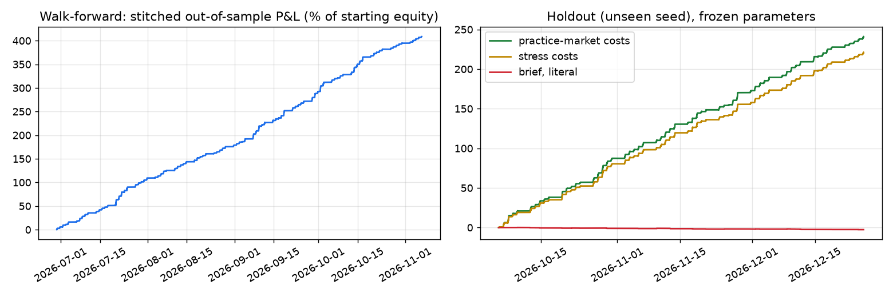

# AT — backtest and walk-forward report

History: Gomer Trading's practice-market model, one-minute bars, 12 symbols, US exchange hours with an overnight price gap each morning (as the app's practice market now runs). Parameters were chosen on 120 sessions and then tested once on a separate 60-session history from a different random seed that played no part in choosing them.

\* Return is on a fixed $100,000 base with no compounding, so periods can be compared.

## 1. The brief, taken literally

Fade stretched prices in a ranging regime; target the mean; stop at 3.5 deviations.

| regime gate | trades | win rate | avg trade (bps) | t-stat | profit factor | return* |
|---|---|---|---|---|---|---|
| as written (ADX < 20 **or** Hurst < 0.5) | 43 | 14.0% | -25.66 | -3.6 | 0.29 | -2.7% |
| strict (ADX < 20 **and** Hurst < 0.5) | 7 | 14.3% | -35.72 | -4.3 | 0.11 | -0.6% |

## 2. What the search found, by playbook (main history)

| playbook | candidates with enough trades | profitable | median win rate | median avg trade (bps) | best t-stat |
|---|---|---|---|---|---|
| continuation | 300 | 300 | 89.3% | +13.62 | +117.7 |

## 3. Walk-forward

19 folds: choose on 28 days, test on the next 7. 300 candidates.

| fold | chosen playbook | in-sample win rate | in-sample bps | out-of-sample trades | out-of-sample win rate | out-of-sample bps |
|---|---|---|---|---|---|---|
| 1 | continuation | 91.7% | +16.51 | 422 | 90.3% | +15.44 |
| 2 | continuation | 91.7% | +16.06 | 534 | 88.6% | +14.63 |
| 3 | continuation | 90.6% | +15.55 | 378 | 89.7% | +16.56 |
| 4 | continuation | 90.2% | +13.88 | 1,162 | 89.2% | +13.50 |
| 5 | continuation | 90.2% | +21.78 | 376 | 91.0% | +20.55 |
| 6 | continuation | 90.5% | +21.67 | 277 | 92.8% | +23.23 |
| 7 | continuation | 91.3% | +22.30 | 370 | 89.5% | +19.97 |
| 8 | continuation | 91.4% | +20.01 | 371 | 86.8% | +18.25 |
| 9 | continuation | 90.2% | +19.46 | 316 | 88.3% | +19.22 |
| 10 | continuation | 90.0% | +19.69 | 346 | 89.3% | +19.06 |
| 11 | continuation | 90.3% | +8.11 | 1,776 | 90.7% | +7.91 |
| 12 | continuation | 90.4% | +8.10 | 1,395 | 88.5% | +7.20 |
| 13 | continuation | 90.9% | +9.77 | 869 | 90.2% | +9.26 |
| 14 | continuation | 90.5% | +14.19 | 1,117 | 90.4% | +14.45 |
| 15 | continuation | 90.9% | +19.97 | 376 | 87.0% | +17.38 |
| 16 | continuation | 90.0% | +13.67 | 1,096 | 89.4% | +13.68 |
| 17 | continuation | 92.0% | +16.63 | 437 | 91.3% | +15.31 |
| 18 | continuation | 92.0% | +16.74 | 364 | 89.8% | +14.04 |
| 19 | continuation | 91.1% | +15.85 | 359 | 90.3% | +15.60 |

Stitched out-of-sample record:

```
  trades               12341  (129.9 per day over 95 days)
  win rate             89.7%   (95% interval 89.1% to 90.2%)
  average win / loss   $48.00 / $-96.15   (payoff ratio 0.50)
  profit factor        4.33
  expectancy           $33.11 per trade   (13.33 bps, 0.256 R, t = 77.68)
  net profit           $408,578.15   (408.6% of starting equity)
  worst trade          $-402.32   (-1.10 R, 8.4x the average win)
  longest losing run   7 trades
  average hold         1.4 bars
  max drawdown         0.5%
  daily Sharpe (ann.)  26.32   worst day +0.3%, profitable days 100.0%
  exits                session_end 45 (51.1% won), stop 713 (0.0% won), target 10805 (100.0% won), time 778 (30.6% won)
```

Overfitting checks:

- **Walk-forward efficiency 0.87** (out-of-sample edge ÷ in-sample edge; near 1 is good, near 0 is a curve fit).
- **Rank correlation +0.36** between a candidate's in-sample and out-of-sample results.
- **Probability of overfit 47%** (how often the in-sample winner fell in the bottom half out-of-sample).
- **Trials hurdle t = 3.4**: the best of 300 worthless candidates would reach about this by luck.
- Out-of-sample folds profitable: 19 of 19.

## 4. Holdout: frozen parameters on a history they have never seen

| costs | trades | win rate | avg trade (bps) | t-stat | profit factor | return* |
|---|---|---|---|---|---|---|
| practice market (1¢ taker slippage, no commission) | 5,947 | 91.4% | +16.30 | +76.8 | 6.60 | +240.8% |
| stress (double slippage, $0.005/share commission, pessimistic queue) | 5,899 | 91.0% | +15.07 | +69.4 | 5.81 | +220.8% |
| the previous configuration, for comparison | 16,656 | 85.9% | +12.92 | +74.0 | 2.87 | +534.6% |

```
  trades               5947  (99.1 per day over 60 days)
  win rate             91.4%   (95% interval 90.7% to 92.1%)
  average win / loss   $52.19 / $-84.52   (payoff ratio 0.62)
  profit factor        6.60
  expectancy           $40.49 per trade   (16.30 bps, 0.235 R, t = 76.78)
  net profit           $240,809.73   (240.8% of starting equity)
  worst trade          $-402.54   (-1.06 R, 7.7x the average win)
  longest losing run   6 trades
  average hold         1.3 bars
  max drawdown         0.5%
  daily Sharpe (ann.)  27.44   worst day +0.2%, profitable days 100.0%
  exits                session_end 17 (41.2% won), stop 94 (0.0% won), target 5276 (100.0% won), time 560 (27.7% won)
```

Orders sent 5,947, filled 100%. Circuit-breaker halts: 0.

### How steady is the success rate?

An average hides bad stretches. The same holdout, cut into half-hours (with at least 8 trades) and into sessions:

| | this configuration | previous configuration |
|---|---|---|
| overall success rate | 91.4% | 85.9% |
| typical half-hour (median) | 94% | 87% |
| a poor half-hour (1 in 4 is worse) | 88% | 78% |
| a bad half-hour (1 in 20 is worse) | 76% | 62% |
| half-hours under 70% | 1.0% | 12.1% |
| half-hours that lost money | 1.0% | 10.4% |
| worst session | 76% | 77% |
| typical session (median) | 91% | 85% |
| sessions under 80% | 2 of 60 | 4 of 60 |
| sessions that lost money | 0 of 60 | 0 of 60 |
| trades per session (median) | 94 | 278 |

## 5. Is the win rate the signal, or just the exit?

A small target and a wide stop win most of the time on any entry. Same exits, same number of entries, random bars:

| entries | win rate | avg trade (bps) |
|---|---|---|
| the strategy's signals | 91.4% | +16.30 |
| random bars (5 runs) | 60.5% | -12.58 |

## 6. What each filter contributes (holdout)

| variant | trades | win rate | avg trade (bps) | t-stat | profit factor | return* |
|---|---|---|---|---|---|---|
| all filters (as chosen) | 5,947 | 91.4% | +16.30 | +76.8 | 6.60 | +240.8% |
| without the regime gate | 6,514 | 91.1% | +16.39 | +78.4 | 6.27 | +265.4% |
| without RSI(2) | 6,321 | 90.8% | +16.03 | +74.6 | 6.14 | +251.7% |
| without the VWAP band | 9,367 | 89.7% | +15.37 | +80.9 | 5.23 | +357.7% |
| with the order-flow filter | 1,238 | 91.8% | +15.61 | +33.7 | 6.13 | +48.0% |
| without the loss-review filters | 15,063 | 86.2% | +13.45 | +74.1 | 3.31 | +503.3% |

## 7. A market with nothing to predict

Eight random walks with a spread, 30,000 minutes each. A correct backtest should lose roughly its costs here.

| trades | win rate | avg trade (bps) | t-stat | profit factor | return* |
|---|---|---|---|---|---|
| 142 | 65.5% | -0.56 | +0.3 | 0.91 | -0.5% |

## 8. By the practice market's hidden mood (diagnostic; the strategy never sees this)

| mood | trades | win rate | avg trade (bps) | t-stat | profit factor | return* |
|---|---|---|---|---|---|---|
| CALM | 2,161 | 92.4% | +15.18 | +53.1 | 8.73 | +81.5% |
| RALLY | 1,475 | 92.3% | +16.84 | +39.6 | 6.80 | +61.7% |
| SELLOFF | 150 | 87.3% | +19.47 | +7.9 | 3.54 | +7.3% |
| STEADY | 2,115 | 90.4% | +16.82 | +41.4 | 5.89 | +88.3% |
| TURBULENT | 46 | 82.6% | +17.30 | +3.6 | 3.18 | +2.0% |

## 9. Chosen configuration

Differences from the brief's literal settings:

```json
{
  "playbook": "continuation",
  "regime_tf_sec": 60,
  "adx_max": 30.0,
  "bbw_max_pctile": 0.8,
  "rsi_low": 5.0,
  "rsi_high": 95.0,
  "entry_z": 2.0,
  "use_absorption": false,
  "absorb_rel_volume": 1.0,
  "absorb_wick_frac": 0.2,
  "entry_style": "marketable",
  "target_frac": 0.15,
  "max_hold_bars": 10,
  "cont_max_hold_bars": 5,
  "cont_min_di_gap": 40.0,
  "cont_max_wick": 0.4,
  "max_rel_volume": 1.5
}
```


